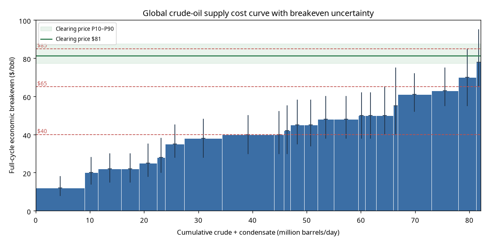
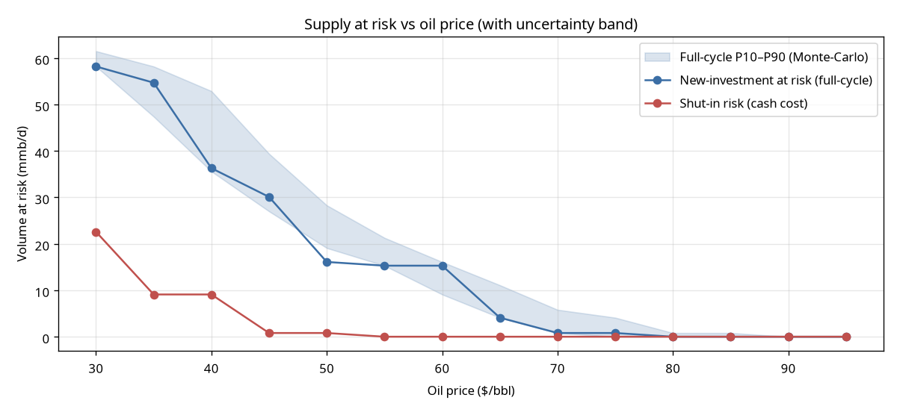
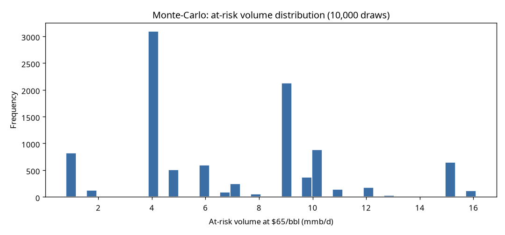
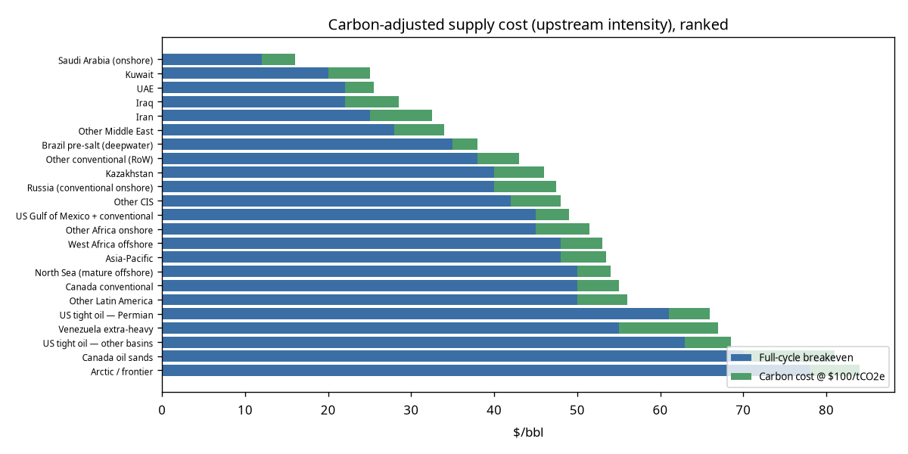

# crude-oil-supply-cost-curve

**Global crude-oil supply cost curve: breakeven benchmarking with uncertainty.**
An energy-market analytical tool that ranks world crude + condensate supply by
*economic* breakeven ($/bbl), builds the cumulative supply cost curve, clears an independent demand curve
against it, and quantifies how much production is uneconomic
at a given oil price, with Monte-Carlo uncertainty, cost-inflation scenarios, and a
written insight memo. Implemented as an **interactive Excel workbook** (live SUMIF)
and an **auditable, unit-tested Python engine** that agree exactly.

[](https://github.com/Pr0spektor/crude-oil-supply-cost-curve/actions/workflows/ci.yml)

Author: **[Pr0spektor](https://github.com/Pr0spektor)**

---

## Running it: data and API keys

**Clone and run. No key, no account, no signup.** Every figure and every number in
[INSIGHT_MEMO.md](INSIGHT_MEMO.md) comes from the sourced dataset bundled in `src/data.py`,
so the published result is auditable by anyone without credentials:

```bash
git clone https://github.com/Pr0spektor/crude-oil-supply-cost-curve.git
cd crude-oil-supply-cost-curve
pip install -r requirements.txt
python tests/test_costcurve.py     # 26 engine tests (+3 data guards, +16 demand tests under pytest)
python src/analysis.py             # charts + results/summary.json + INSIGHT_MEMO.md
```

**To refresh prices from the live EIA feed**, supply your own key. The repo never ships one:

| Source | Key needed? | How to get it |
|---|---|---|
| Bundled breakeven dataset (`src/data.py`, 23 sourced nodes) | no | in the repo, with citations in [SOURCES.md](SOURCES.md) |
| **EIA**, live crude price series | yes, free | instant registration at [eia.gov/opendata/register.php](https://www.eia.gov/opendata/register.php) |

```bash
cp .env.example .env      # then paste your key into EIA_API_KEY
python src/fetch.py       # or one-off: EIA_API_KEY=... python src/fetch.py
```

`.env` is git-ignored; `.env.example` ships empty. `src/fetch.py` reads the key from the
environment or from `.env`, and falls back to the bundled dataset whenever a key is absent
or the network is unavailable, so nothing here can break for want of a credential.

## The question it answers
*"Oil falls to $40/bbl — how much supply is underwater, which segment sets the
marginal price, and where does new investment stop making sense?"* — read straight
off the curve, with the uncertainty around the answer made explicit.

## Headline results (23 publicly-anchored nodes, ≈82 mmb/d crude + condensate)

| Oil price | New-investment at risk (full-cycle) | Shut-in risk (cash) | Full-cycle P10–P90 (Monte-Carlo) |
|---|---|---|---|
| **$40** | 36.3 mmb/d (44%) | 9.1 mmb/d | 35.6 – 52.9 |
| **$65** | 4.1 mmb/d (5%) | 0 | 4.1 – 11.1 |
| **$85** | 0 | 0 | 0 – 0.8 |

**Clearing price ≈ $83/bbl** (P10–P90 $78–$94) against an independent demand of ≈82.3 mmb/d at $80.
**Clearing price ≈ $81/bbl** (P10–P90 $77–$88) against an independent demand of ≈82.3 mmb/d at $80.
The cost curve alone delivers 82.1 mmb/d, so the 0.2 mmb/d gap is closed by **0.12 mmb/d of OPEC+
spare** — 3% of the 4 mmb/d that exists. The swing barrel sets the price in **73%** of Monte-Carlo
draws, the Arctic/frontier in **20%** and Canadian oil sands in **5%** — the marginal barrel is a
probability, not a fact. A **+15%** cost shock lifts the clearing price to **$86** and at-risk
volume at $65 to ≈15 mmb/d.
*US-shale nodes use Dallas Fed Q1 2025 breakevens ($61–63 new well; $33–41 shut-in).*

**Why the price is not simply $78.** Demand is a price-elastic curve anchored on published
crude demand (82.3 mmb/d at $80/bbl, EIA; IEA's 83.2 mb/d refinery runs bound the range), not
on the supply build-up. The earlier version set demand equal to modelled supply, which made the
most expensive node marginal by construction: a 0.01 mmb/d change moved the answer from $70 to
$78 and no uncertainty was attached. When demand at the top of the curve exceeds what the curve
can deliver, the gap is offered to OPEC+ swing capacity rather than priced as rationing: spare
enters as a linear supply curve from $80 to $120/bbl, 4 mmb/d at the midpoint of EIA/IEA effective
spare estimates. Only when that is exhausted does the price become a rationing price, and the
model says so. Both the point estimate and the P10–P90 band come from that balance
(`src/demand.py`, `src/spare.py`).





**→ One-page findings: [INSIGHT_MEMO.md](INSIGHT_MEMO.md)** (produced from the model; numbers reconcile).

## What makes it decision-grade
- **Two cost views, not conflated.** Full-cycle (new-investment) vs cash cost
  (shut-in), and *fiscal* breakeven explicitly excluded. See [docs/METHODS.md](docs/METHODS.md).
- **Uncertainty, not false precision.** Every breakeven carries a (low, high) range;
  Monte-Carlo (10k seeded draws) reports P10/P50/P90 of the at-risk volume.
- **Scenarios.** Price stress and cost-inflation grid.
- **Carbon-cost overlay.** An upstream-carbon-intensity ($/tCO2e) lens that re-ranks
  the merit order (transition risk), grounded in Masnadi et al. (2018).
- **Sourced data.** Dallas Fed, EIA, IEA, Rystad, Masnadi *Science* ([SOURCES.md](SOURCES.md)).
- **A model, not just a ranking.** `src/equilibrium.py` clears the market against a
  constant-elasticity demand curve, solving for the equilibrium price/volume (shift demand
  or shock costs and read the new price).
- **Polyglot and reconciled.** The core engine is implemented in **Excel (live formulas +
  VBA), Python, JavaScript and R**, all agreeing on the same results.
- **Validated.** `src/validate.py` asserts data invariants (run in CI).
- **Live-data ready.** `src/fetch.py` refreshes production from the EIA open API
  (cached, with graceful offline fallback to the bundled data; needs `EIA_API_KEY`).
- **Synthesis.** A McKinsey-style insight memo with the "so what".



## Repository layout
```
src/costcurve.py     # engine: curve, marginal barrel, at-risk, Monte-Carlo, inflation (stdlib)
src/equilibrium.py   # market-clearing model: supply curve x demand curve -> clearing price
src/data.py          # 23 sourced supply nodes (production, full & cash breakeven, ranges)
js/costcurve.js      # JavaScript port of the core engine (+ js/costcurve.test.js)
r/costcurve.R        # R port with self-test (Rscript r/costcurve.R)
vba/CostCurve.bas    # Excel VBA module (AtRiskVolume / EconomicVolume / MarginalBarrel)
src/analysis.py      # charts + summary.json + model-driven INSIGHT_MEMO.md
src/build_workbook.py# model.xlsx: Outputs (live SUMIF) · Data · CostCurve · Scenarios · MonteCarlo
tests/test_costcurve.py # 26 engine tests + 3 data guards + 11 demand tests (45 under pytest)
docs/METHODS.md · SOURCES.md · INSIGHT_MEMO.md
```

## Run it
```bash
python src/analysis.py        # charts + memo + summary.json
python src/build_workbook.py  # interactive model.xlsx
python tests/test_costcurve.py   # 26/26, standalone …
pytest -q                        # … or under pytest (CI)
```
Open **`model.xlsx`**, change the oil-price cell on **Outputs**, and at-risk volumes
recompute via `SUMIF` (no macros). Verified by recalculating headless in LibreOffice.

## Caveats
Publicly-anchored, simplified (23-node) planning inputs, not a licensed asset-level
database, not investment advice. See METHODS/SOURCES for full provenance and limits.

## License
MIT. See [LICENSE](LICENSE).

## Data freshness

The demand anchor and the breakeven bands are constants in `src/`, taken from a dated STEO
vintage and the Dallas Fed survey. `tools/refresh_eia.py` fetches the current vintage from
EIA's **bulk archive** — a static 18 MB zip at `api.eia.gov/bulk/STEO.zip`, no API key, no
rate limit — writes `data/eia_steo_snapshot.json`, and prints how far the anchor has moved.

```bash
python tools/refresh_eia.py --list-series "world crude"   # find a series id, no key needed
python tools/refresh_eia.py --write                       # fetch, validate, write
python tools/refresh_eia.py --check 150                   # age gate, used in CI
```

Checked against the November 2026 vintage: world crude production is **82.15 mmb/d** for
2027-12 against the model's **82.30 mmb/d** anchor — a drift of **-0.15 mmb/d**, i.e. the
anchor still holds. Total liquids consumption is 106.03 mmb/d and is reported as context
only: it includes NGLs, biofuels and processing gains, so it is not comparable with a crude
anchor. That distinction is the reason the tool compares one series and not the other.

`.github/workflows/data-refresh.yml` runs monthly and opens a pull request when the
snapshot moves. Series IDs live in `tools/eia_series.json` because EIA re-issues them
between vintages; an unset id is skipped with a warning instead of silently returning
nothing.
